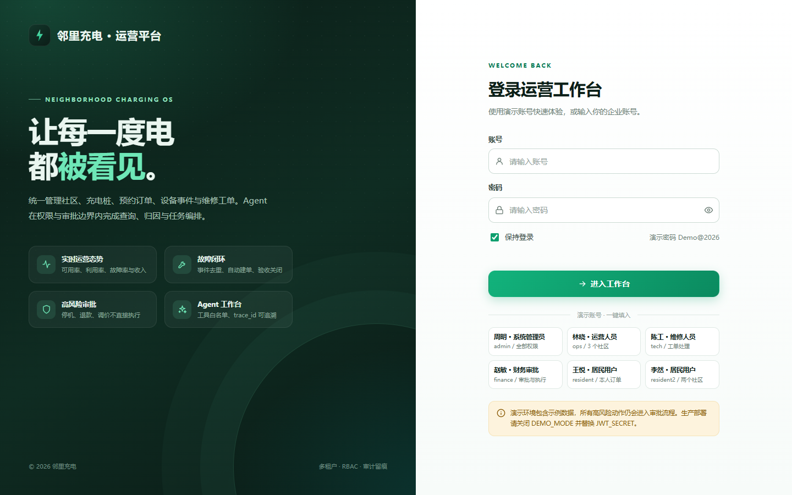
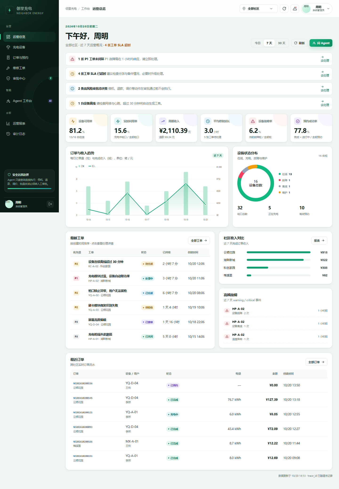
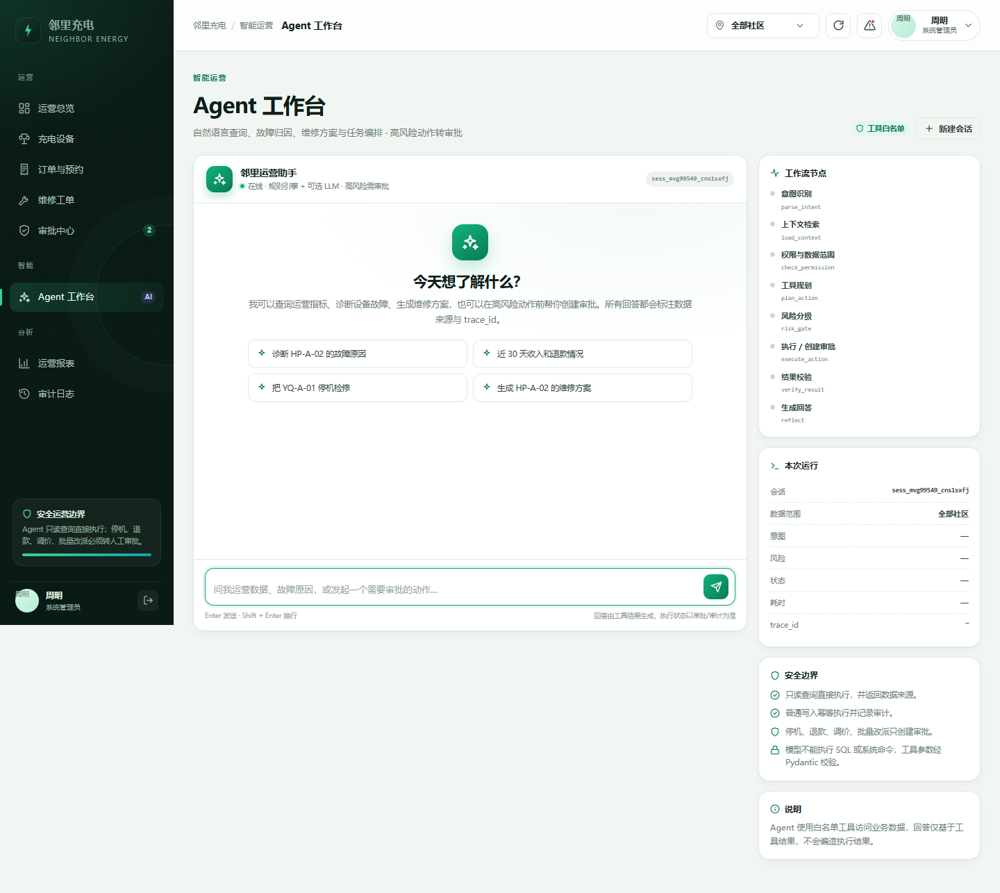

# 邻里充电 · 多社区充电运营平台

> 面向物业、运营、维修、财务与居民的统一充电运营工作台。  
> 前端原生 HTML / CSS / JavaScript，后端 FastAPI + SQLAlchemy，Agent 高风险动作强制转审批。

**在线演示：<https://neighborhood-charging.netlify.app>**（`admin` / `Demo@2026`）

> 生产链路：Netlify 前端与 `/api` Function 代理 → Vercel FastAPI → Neon PostgreSQL，LLM 使用 DeepSeek。  
> 后端已持久化，**本地无需运行 FastAPI、Docker 或隧道**。部署细节见 [DEPLOY.md](DEPLOY.md)。



## 目录

- [项目亮点](#项目亮点)
- [功能地图](#功能地图)
- [技术架构](#技术架构)
- [快速开始](#快速开始)
- [演示账号](#演示账号)
- [项目结构](#项目结构)
- [核心 API](#核心-api)
- [Agent 工作流](#agent-工作流)
- [安全与权限](#安全与权限)
- [测试](#测试)
- [部署到 Netlify](#部署到-netlify)
- [文档](#文档)

## 项目亮点

- **多租户 + RBAC + 社区数据范围**：前端菜单只做体验优化，服务端对每个接口再次校验租户、角色与社区。
- **完整业务链路**：社区 → 充电桩/枪口 → 预约 → 订单 → 设备事件 → 自动工单 → 维修验收 → 审批/审计。
- **设备事件幂等**：`event_no` 唯一去重，重复投递不重复建单；故障事件自动生成 P1/P2/P3 工单并按 SLA 升级。
- **预约冲突防护**：同一枪口时间段重叠会被拒绝；订单支持 `Idempotency-Key`，重复提交返回首次结果。
- **工单关闭门禁**：必须先完成维修回填、设备心跳检查和已完成测试订单验证，才能关闭。
- **高风险动作不直接执行**：停机、退款、调价、批量改派只能创建审批；审批与执行均记录审批人、时间、影响范围、金额与回执。
- **Agent 可追溯**：内置工具白名单、Pydantic 参数校验、风险分级、数据来源、`trace_id` 与运行记录；可选接入 OpenAI 兼容 LLM 润色回答。
- **零构建前端**：原生 ES Modules + SVG 图表，不依赖 React/Vue/CDN，Netlify 直接托管。
- **可部署**：Netlify 前端 + Function 同源代理 + Vercel FastAPI + Neon PostgreSQL，附完整部署配置。



## 功能地图

| 模块 | 能力 |
|---|---|
| 身份与组织 | 登录、JWT 续期/撤销、密码修改、角色授权、社区范围、登录失败限流、审计 |
| 社区与设备 | 社区/区域/充电桩/枪口管理查询、在线状态、温度/功率/心跳、可用枪口查询 |
| 预约与订单 | 立即充电、时段预约、冲突校验、幂等创建、开始/结束/取消、退款记录 |
| 设备事件 | 心跳、功率、电流、温度、离线、中断、故障、恢复；事件去重、状态机、自动建单、SLA 升级 |
| 工单与维修 | 分派、接单、处理中、维修回填、测试订单验收、心跳复核、关闭、取消 |
| 审批与财务 | 停机、退款、调价、批量改派申请；通过/驳回；执行锁、回执、防重复审批/执行 |
| 报表 | 可用率、利用率、故障率、MTTR、预约成功率、收入、退款、社区对比、订单 CSV |
| Agent 工作台 | 自然语言查询、故障归因、维修方案、指标解释、审批发起、工具轨迹、数据来源、会话记忆 |
| 审计 | 登录、设备事件、订单、工单、审批、Agent 工具调用全链路留痕与查询 |

## 技术架构

```text
浏览器（原生 HTML/CSS/JS）
        │ 同源 /api
        ▼
Netlify CDN + Netlify Function（仅反向代理，不做业务）
        │ HTTPS
        ▼
FastAPI + SQLAlchemy + JWT/RBAC
        │
        ├── SQLite（开发/演示） / PostgreSQL（生产）
        ├── Agent 工具白名单 + 风险分级 + 审批门禁
        └── 可选 OpenAI 兼容 LLM（仅润色，不直接执行动作）
```

> **为什么需要独立后端？** Netlify Functions 官方支持 JavaScript/TypeScript/Go，不提供 Python 运行时，无法直接托管 FastAPI。项目采用 Netlify 托管前端，通过 Function 反向代理到 Docker 化的 FastAPI；详见 [DEPLOY.md](DEPLOY.md)。

## 快速开始

环境要求：Python 3.11+（推荐 3.12）。

```powershell
python -m venv .venv
.\.venv\Scripts\Activate.ps1
pip install -r requirements.txt
Copy-Item .env.example .env
python run.py
```

打开 <http://127.0.0.1:8000>，使用下方演示账号登录。

**本地数据库（可选）**：`.env` 已配置 PostgreSQL/MySQL 时，先启动 Docker 依赖：

```powershell
docker compose up -d
```

然后 `python run.py` 会自动使用 PostgreSQL（`POSTGRES_URL`）并创建表、写入演示数据。MySQL 连接（`MYSQL_URL`）同样会启动并可通过驱动验证，但当前单库实现以 PostgreSQL 承载业务表，MySQL 预留给后续身份库拆分。若数据库暂不可达，演示模式会回退到 SQLite 并打印警告；`ALLOW_SQLITE_FALLBACK=false` 可关闭回退。

首次启动会自动写入可复现的演示数据（4 个社区、16 台设备、180 笔订单、工单、审批、设备事件）。删除 `data/charging.db` 或清空 Docker 数据卷后重启即可重置。

也可以使用 `uvicorn` 直接启动：

```powershell
uvicorn app.main:app --reload --port 8000
```

## 演示账号

统一密码：`Demo@2026`

| 账号 | 姓名 | 角色 | 数据范围 |
|---|---|---|---|
| `admin` | 周明 | 系统管理员 | 全部社区 + 审计 |
| `ops` | 林晓 | 运营人员 | 云栖花园、湖畔新城、科创家园 |
| `tech` | 陈工 | 维修人员 | 云栖花园、湖畔新城 |
| `finance` | 赵敏 | 财务/审批 | 全部社区 |
| `resident` | 王悦 | 居民用户 | 云栖花园，仅本人订单 |
| `resident2` | 李然 | 居民用户 | 云栖花园、湖畔新城 |

> 演示账号仅用于本地展示；生产部署请关闭 `DEMO_MODE`，移除演示用户并替换 `JWT_SECRET`。

## 项目结构

```text
app/
├── main.py                 # 应用入口、中间件、异常处理、静态资源
├── auth.py                 # JWT、PBKDF2、RBAC、社区范围
├── config.py               # Pydantic Settings 环境配置
├── db.py                   # SQLite/PostgreSQL 连接与会话
├── models.py               # 17 张业务表 ORM 模型
├── schemas.py              # 请求参数模型
├── serializers.py          # 统一序列化（UTC Z、脱敏）
├── seed.py                 # 可复现演示数据
├── routers/                # auth/社区设备/订单/工单/审批/报表/审计/Agent/用户
├── services/               # 订单、事件、工单、审批、指标、幂等、审计、心跳模拟
└── agents/                 # 工具白名单与轻量工作流图
static/
├── index.html
├── css/app.css
└── js/                     # api/store/ui/charts/pages/main
database/init.sql           # PostgreSQL 参考建表脚本
netlify/functions/          # Netlify 同源 API 代理
scripts/build_netlify.py    # Netlify 静态构建
tests/                      # 40 项自动化测试
docs/                       # 需求、架构、开发、部署、安全与实现说明
```

## 核心 API

所有业务接口需要 `Authorization: Bearer <token>`；写接口支持 `Idempotency-Key`；响应头带 `X-Trace-Id`。

| 方法 | 路径 | 说明 |
|---|---|---|
| POST | `/api/auth/login` | 登录并签发访问/刷新令牌 |
| POST | `/api/auth/refresh` | 刷新令牌轮换 |
| GET | `/api/auth/me` | 当前用户、租户、菜单与社区范围 |
| GET | `/api/communities` | 授权社区列表 |
| GET | `/api/piles` | 设备列表（状态、关键词、分页） |
| GET | `/api/piles/{id}` | 设备档案、枪口、事件、工单、订单 |
| GET | `/api/availability` | 指定社区/时段的可用枪口 |
| GET/POST | `/api/orders` | 订单查询 / 创建（立即充电或预约） |
| POST | `/api/orders/{id}/start` | 开始充电 |
| POST | `/api/orders/{id}/complete` | 结束充电并结算 |
| POST | `/api/orders/{id}/cancel` | 取消预约/待支付订单 |
| GET/POST | `/api/tickets` | 工单列表 / 创建 |
| POST | `/api/tickets/{id}/assign` | 分派 |
| POST | `/api/tickets/{id}/accept` | 接单 |
| POST | `/api/tickets/{id}/start` | 开始处理 |
| POST | `/api/tickets/{id}/resolve` | 维修回填 |
| POST | `/api/tickets/{id}/verify` | 测试订单 + 心跳验收 |
| POST | `/api/tickets/{id}/close` | 关闭工单（需验收通过） |
| GET/POST | `/api/approvals` | 审批查询 / 创建高风险申请 |
| POST | `/api/approvals/{id}/decide` | 财务/管理员审批 |
| POST | `/api/approvals/{id}/execute` | 执行已通过审批 |
| POST | `/api/device-events` | 设备事件接入（支持设备密钥） |
| GET | `/api/dashboard` | 运营指标总览 |
| GET | `/api/reports/overview` | 运营报表 |
| GET | `/api/reports/orders.csv` | 订单导出 |
| GET | `/api/audit` | 审计日志（仅管理员） |
| POST | `/api/agent/chat` | Agent 工作流 |
| GET | `/api/agent/suggestions` | 角色化推荐问题 |
| GET | `/api/health` | 健康检查（数据库连通性） |

完整交互式文档：本地启动后访问 <http://127.0.0.1:8000/docs>（生产环境默认关闭）。

## Agent 工作流

节点：`parse_intent → load_context → check_permission → plan_action → risk_gate → request_approval / execute_action → verify_result → write_memory → reflect`。

| 工具 | 风险 | 说明 |
|---|---|---|
| `operations_overview` | 只读 | 运营总览、收入、可用率、工单 |
| `pile_health` | 只读 | 设备健康与枪口占用 |
| `diagnose_pile` | 只读 | 结合事件/工单/订单做故障归因 |
| `order_analytics` | 只读 | 订单、收入、退款与电量 |
| `my_orders` | 只读 | 居民本人订单 |
| `ticket_overview` | 只读 | 工单积压、P1、SLA |
| `check_availability` | 只读 | 时段可用枪口 |
| `repair_plan` | 只读 | 生成检修步骤 |
| `metric_glossary` | 只读 | 指标口径解释 |
| `create_ticket` | 普通写 | 创建工单并审计 |
| `request_stop_pile` | 高风险 | 仅创建停机审批 |
| `request_refund` | 高风险 | 仅创建退款审批 |
| `request_price_change` | 高风险 | 仅创建调价审批 |
| `request_bulk_reassign` | 高风险 | 仅创建批量改派审批 |

安全约束：

- 模型只能调用登记工具，参数由 Pydantic 模型校验，禁止 SQL/系统命令。
- 高风险工具只写审批，不执行；回答固定标注「待审批 · 未执行」。
- 每次运行写入 `agent_runs` 与审计，返回数据来源、工具轨迹、耗时、`trace_id`。
- 短期记忆按租户/用户/会话隔离，30 分钟 TTL；长期记忆只写摘要，脱敏后保存。



## 安全与权限

- 密码使用 PBKDF2-HMAC-SHA256（210,000 次迭代，随机盐），不保存明文。
- 访问令牌 JWT HS256，默认 8 小时；刷新令牌随机 48 字节，哈希存储，支持轮换与撤销。
- 登录失败限流（进程内实现，生产建议 Redis）。
- 所有业务查询强制 `tenant_id`；非管理员再叠加社区范围；居民只能访问本人订单/工单。
- 写操作使用数据库事务；订单、审批、事件均支持幂等/去重。
- 审计日志只读，记录操作者、角色、动作、资源、trace_id、IP、结果。
- 响应安全头：CSP、X-Content-Type-Options、X-Frame-Options、Referrer-Policy、Permissions-Policy。
- 日志不记录密码、令牌、支付密钥；手机号在序列化时脱敏。

## 测试

```powershell
pytest
python -m compileall app
```

覆盖：认证与令牌、RBAC、租户隔离、社区范围、订单幂等、预约冲突、订单状态机、事件去重、自动建单、工单完整验收链路、审批通过/执行/防重复、退款金额校验、Agent 只读/归因/高风险拦截/居民权限、报表与 CSV、审计。

当前结果：**40 passed**。

## 部署到 Netlify

推荐架构：

```text
Netlify（静态站点 + /api 代理 Function）
        │ API_BASE_URL
        ▼
Render / Railway / Fly.io / Docker（FastAPI + PostgreSQL）
```

最短路径：

1. 用 `render.yaml` 在 Render 创建 FastAPI + PostgreSQL（或构建 `Dockerfile` 部署到任意容器平台）。
2. 在 Netlify 设置环境变量 `API_BASE_URL=https://你的后端域名`。
3. 推送仓库并在 Netlify 导入，构建命令与发布目录已由 `netlify.toml` 配置。
4. 访问 `https://<site>.netlify.app/api/health` 验证代理。

完整步骤、环境变量、故障排查见 **[DEPLOY.md](DEPLOY.md)**。

> 当前执行环境未提供 Netlify / Render 账号凭据，因此仓库已完成可部署配置与本地验证，但未代替你执行线上发布。

## 文档

- [项目需求文档](docs/01_项目需求文档.md)
- [系统架构文档](docs/02_系统架构文档.md)
- [开发文档](docs/03_开发文档.md)
- [部署与运维手册](docs/04_部署与运维手册.md)
- [安全与合规说明](docs/05_安全与合规说明.md)
- [实现与架构落地说明](docs/06_实现与架构落地说明.md)

## License

本项目为演示/教学用途，未附带生产 SLA。上线前请完成安全评估、依赖扫描、备份恢复演练与压力测试。
